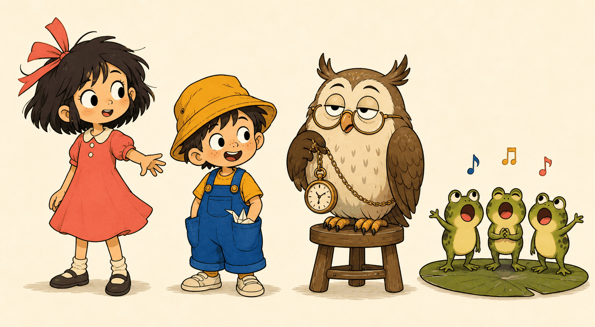

<p align="center">
  
</p>

<h1 align="center">종이달 다락방 탈출</h1>
<p align="center"><b>Paper Moon Escape</b> · 코지 힐링 포인트 앤 클릭 방탈출</p>
<p align="center">iOS 17+ · SwiftUI · Swift 5.9 · XcodeGen</p>
<p align="center"><sub>아치형 나무 창 너머로 종이달이 은은하게 떠 있고, 창턱에는 모모와 고양이 피코가 나란히 앉아 달을 올려다본다.<br> 옆의 작은 촛불 랜턴이 창틀을 따뜻하게 물들인다. 텍스트 없이 꽉 찬 1024×1024 일러스트가 앱 아이콘이다.</sub></p>

---

## 이 게임은

비 오는 토요일 오후, 다락방에서 놀던 **모모**와 고양이 **피코**가 종이로 접힌 달 속으로 빨려 들어간다.
세 개의 종이 세계를 지나 다시 다락방으로 돌아오는, 한 시간 남짓의 짧고 포근한 모험.

- 설명 대신 **만져 보고 조합하는** 진행. 대사는 짧고, 표정과 소품이 이야기를 대신한다.
- 크림색 종이 바탕에 우드·촛불 오렌지·더스티 로즈·소프트 라벤더·세이지. 윤곽은 굵은 검정 잉크가 아니라 **가는 코코아색 선**이라, 화면 전체가 한 장의 그림책 페이지처럼 보인다.
- 캐릭터는 동글동글한 비율에 작은 점 눈, 옅은 홍조. 목소리를 높이지 않고, 방마다 촛불과 스탠드 빛이 낮게 깔린다.
- 방탈출의 규칙은 정직하다. **본 것은 다 쓸 수 있고, 쓴 것은 반드시 흔적을 남긴다.**
- 손으로 만지는 기믹이 네 가지 더 있다. **종이접기**, **빛 투과**, **모모 ↔ 고양이 피코 전환**, **먼지 닦기(문지르기·기울이기·흔들기)**.
- 아이템은 한 번 눌러 바로 쏟아지지 않는다. **꼼꼼히 더듬는 탐색**을 몇 번 해야 나오고, 몇 번 시도하면 **반드시** 나오는 천장이 있다(무한 노가다 없음).
- 방마다 숨어 있는 **접힌 종이학 12마리**를 모으면 엔딩 뒤 다락방 비밀 서랍이 열린다. 종이학 세 마리와 우표 한 장은 방을 깊이 더듬어야 나온다.
- 본편을 깨면 유료 보너스 장면 **비밀 다락방 지하실**(세 방 + 새 퍼즐 + 지하실 엔딩)이 이어진다.
- 엔딩 뒤에는 **다락방 놀이방**이 열린다. 본편 아이템과 같은 톤의 미니게임 두 개(기억의 서랍 · 종이접기 연쇄)를 난이도별 기록과 함께 즐긴다.

## 캐릭터

<p align="center">
  
</p>
<p align="center"><sub>왼쪽부터 모모 · 피코 · 부엉이 시계지기 · 개구리 합창단</sub></p>

넷은 같은 크림색 종이 위에 서 있고, 가는 코코아 선 하나로 몸 가장자리를 그었다.
모모의 더스티 로즈 니트와 꿀빛 단발, 피코의 크림색 털과 낡은 리본이 먼저 눈에 들어오고,
그 뒤로 부엉이의 소프트 라벤더와 개구리의 세이지가 따라온다.
색만 봐도 누가 어느 스테이지에서 말을 거는지 짐작할 수 있게 맞춘 배색이다.

| 인물 | 어떻게 생겼나 | 이 이야기에서 하는 일 |
| --- | --- | --- |
| **모모** | 꿀빛 단발에 더스티 로즈 니트 원피스, 흰 깃, 머리 한쪽에 작은 버터색 리본. 눈은 작은 점 두 개, 볼에 옅은 홍조. 리본은 늘 살짝 삐뚤어져 있고, 그녀는 그걸 신경 쓰지 않는다. | 다락방을 처음 열어 본 아이. 무서운 것보다 궁금한 것이 앞서서, 방에 들어서면 제일 먼저 벽과 바닥을 살핀다. 열쇠가 부러지면 붙일 방법부터 찾고, 무언가 깨질 것 같으면 먼저 손을 뻗어 잡아 준다. |
| **피코** | 크림색 털에 동글동글한 몸, 목에 맨 낡은 더스티 로즈 리본, 작은 가슴가방. 수염이 가늘고, 한쪽 귀가 살짝 접혀 있다. 꼬리는 기분에 따라 천천히 흔들린다. | 모모를 따라다니는 작은 고양이 조수. 반딧불이를 제일 좋아하고, 반짝이는 것을 보면 앞발로 오므려 잡으려 든다("따뜻해..."). 가방에는 종이학 날개 끝이 삐져나와 있고, 다락방 문이 종이처럼 접혀 사라진 걸 제일 먼저 알아챈 것도 피코다. |
| **부엉이 시계지기** | 통통한 라벤더빛 몸에 동그란 안경, 반쯤 감긴 눈. 날개에 작은 황동 회중시계를 매달고 나무 의자에 앉아 있다. | 다락방의 졸린 파수꾼. **삐걱 소리에만** 눈을 뜬다. 목마가 크게 흔들린 뒤에야 느릿하게 깨어나("부엉."), 서랍에서 열쇠를 붙일 접착제를 내준다. 서랍은 열어 준 뒤에도 열린 채로 남는다. |
| **개구리 합창단** | 수련잎 위에 나란히 앉은 세 마리. 몸은 세이지색, 배는 크림색, 눈은 머리 위에 동그랗게 올라와 있다. 한 마리는 앞발을 모으고, 한 마리는 고개를 갸웃하고, 한 마리는 볼을 부풀린 채다. | 거꾸로 자라는 온실의 연못가 주민. 물빛이 번뜩이는 **순서를 음으로** 기억한다. 그 노래를 따라 부르면 연못 물이 도랑을 타고 덩굴 문 앞 화분까지 흘러간다. |
| **시계 지기 그림자** | 그림에는 없다. 톱니바퀴 방 구석, 촛농이 굳은 자리에 목소리만 남아 있다. | 태엽이 멈춘 시계탑의 마지막 안내자. 여러 말을 하지 않는다. *"달을 맞추면 너희는 집으로 갈 수 있어. 종 위에, 종이 달을."* — 이 한마디가 마지막 스테이지의 목적이 된다. |

## 게임 방법

**1. 포인트 앤 클릭 탐색**
씬 위의 동그란 지점을 눌러 살핀다. 물건을 얻거나, 자물쇠가 열리거나, 누군가 말을 건다.
좌우 화살표로 방을 오가며, 방은 세 개씩 이어져 있다(끝에서 한 번 더 넘기면 처음 방으로 돌아온다).
점선 돋보기 링은 **꼼꼼히 더듬는 자리**다(아래 2번).
세로 화면을 기준으로 그렸고, 높이가 낮은 가로 화면에서는 씬·대사·주머니가 compact 레이아웃으로 줄어든다.

**2. 꼼꼼히 더듬는 탐색 (아이템 획득 난이도)**
아이템이 놓인 자리는 한 번 눌러 바로 열리지 않는다. 점선 돋보기 링을 누르면 **탐색 시도**가 시작되고, 시도마다 발견 확률이 오른다.

- 시도에 실패하면 먼지·소리·냄새 같은 **관찰 문장**이 나온다. 마지막 두 번은 거의 찾은 단서라 “조금만 더”가 느껴진다.
- **천장 규칙**: 마지막 시도의 확률은 1.0이다. 운이 아무리 나빠도 `3~5번` 안에는 반드시 발견된다. 아이템이 영영 안 나와 막히는 일은 없다.
- 링 오른쪽 위에 지금까지 빗나간 횟수(`2/5`)가 쌓인다. 방을 나갔다 와도, 앱을 껐다 켜도 그대로다.
- 캐릭터와 도구가 맞아야 더듬을 수 있다. 높은 선반은 모모, 쥐구멍·벽돌 틈·반딧불이는 피코, 반딧불이 곁 풀숲은 **랜턴을 든 채**여야 보인다.

| 자리 | 무엇이 나오나 | 확률(시도 순) | 천장 |
| --- | --- | --- | --- |
| 계단참 · 높은 선반 (모모) | 종이 도면 | 45% → 75% → 100% | 3번 |
| 장난감 창고 · 쥐구멍 (피코) | 짧은 초 | 30% → 50% → 70% → 88% → 100% | 5번 |
| 장난감 창고 · 선반 끝 | 종이학 | 30% → 55% → 80% → 100% | 4번 |
| 종이달 창 · 커튼 주름 (커튼 먼저 살펴보기) | 종이학 | 30% → 55% → 80% → 100% | 4번 |
| 연못가 선반 | 맑은 유리병 | 40% → 70% → 100% | 3번 |
| 반딧불이 떼 (피코) | 반딧불이 | 28% → 48% → 68% → 86% → 100% | 5번 |
| 반딧불이 곁 풀숲 (랜턴 필요) | 종이학 | 30% → 55% → 80% → 100% | 4번 |
| 톱니 더미 (다이얼 먼저) | 작은 톱니바퀴 | 35% → 60% → 82% → 100% | 4번 |
| 나무 상자 밑 | 옛날 우표 | 25% → 50% → 75% → 100% | 4번 |
| 지하실 · 벽돌 틈 (피코) | 녹슨 손잡이 | 40% → 70% → 100% | 3번 |

본편에서 꼭 필요한 여섯 가지(도면·초·유리병·반딧불이·톱니·손잡이)가 모두 이 표에 있다. 한 번 누르면 끝나던 예전 흐름(탭 6번)보다 **필수 아이템을 얻는 데 평균 약 11.6번** 손이 간다. 운이 나빠도 23번이면 전부 손에 들어온다.

**3. 인벤토리와 조합**
화면 아래 **주머니**에 얻은 물건이 쌓인다.

- 물건을 한 번 눌러 **선택**하고, 씬의 지점을 누르면 그 물건을 쓴다. (예: 이어 붙인 열쇠 → 창가의 녹슨 걸쇠)
- 물건을 선택한 상태에서 **다른 물건**을 누르면 둘을 합친다. (예: 열쇠 조각 + 열쇠 조각 → 부러진 열쇠, 부러진 열쇠 + 접착제 → 이어 붙인 열쇠)
- 합쳐지지 않는 조합은 아무 일도 일어나지 않고, 두 물건 모두 그대로 남는다.

**4. 미니게임 퍼즐**
씬 안의 단서를 보고 푸는 퍼즐이 일곱 가지다. 손으로 만지는 두 퍼즐은 **틀리면 대가를 치른다**.

- **네 색 블록 자물쇠** — 벽 그림의 색 순서를 그대로 놓는다.
- **개구리 합창단의 노래** — 연못가 돌의 물빛이 번뜩이는 순서대로 음을 잇는다.
- **세 개의 다이얼** — 문자판 그림과 같은 방향으로 세 고리를 돌린다.
- **종이달 접기** — 도면을 쓸거나 접기 단추로 순서대로 접는다. **한 번 접을 때마다 판정**하고, 순서가 틀리면 **접힘이 전부 풀려 첫 접기부터 다시** 해야 한다(확인 단추 없이 접는 순간이 곧 판정).
- **찢어진 종이 도면** — 찢긴 조각을 칸에 맞추고 랜턴 빛을 비춘다. **한 칸이라도 어긋나면 글씨가 흐릿하게 번지고**(흐림 반경 최대 5.5) 암호는 앞부분만 점으로 보인다. 조각이 모두 제자리에 있어야 또렷해지고 그때 확인할 수 있다. 틀린 칸은 테두리가 로즈빛, 맞는 칸은 세이지빛으로 바로 알려 준다.
- **양피지 배 접기 / 포도주 라벨의 암호** — 보너스 지하실에서 같은 두 방식이 한 번씩 더 나온다.

**5. 2단계 힌트**
오른쪽 위 전구를 누르면 힌트가 나온다. 바로 정답을 주지 않는다.

- **1단계**는 "어디를 볼지"만 알려 준다. (예: *다락방 바닥의 목마가 심심해 보인다.*)
- **2단계**는 구체적인 방법을 알려 준다. (예: *목마를 흔들면 안장 밑에서 열쇠 조각이 떨어진다.*)
- 같은 단계에서 한 번 더 누르면 사용 횟수는 늘지 않고, 목표를 하나 해결하면 다음 목표의 힌트로 넘어간다.
- 무료로는 **힌트 3회**까지. 그 뒤에는 **힌트 무제한 패스**(₩1,500)를 사면 막힐 때마다 바로 물어볼 수 있다.

**6. 모모 ↔ 고양이 피코**
씬 왼쪽 위의 캐릭터 스위치로 두 캐릭터를 오간다. 손이 닿는 곳이 다르다.

- **모모** — 높은 선반, 종이접기, 도구 다루기, 먼지 닦기.
- **피코** — 쥐구멍과 선반 틈새, 반딧불이 잡기, 개구리·부엉이 같은 동물과의 교감.
- 맞지 않는 캐릭터로 지점을 누르면 다그치지 않고, 누가 해야 하는지 코지하게 알려 준다.

**7. 숨은 종이학과 스크랩북**
본편 9개 방마다 반짝이는 수집품이 숨어 있다. 눌러서 주우면 **스크랩북**에 기억 한 줄과 함께 붙는다.

- 종이학 **12마리**를 모두 모으면 엔딩 뒤 다락방 비밀 서랍이 열린다.
- 그중 **세 마리(장난감 선반 끝 · 커튼 주름 · 반딧불이 곁 풀숲)** 는 반짝이로 보이지 않는다. 해당 자리를 **깊이 더듬어야** 나온다.
- 옛날 우표 3장은 모으지 않아도 손해가 없는 곁다리 기록이다. 그중 **한 장(나무 상자 밑)** 도 더듬어야 나온다.
- 스크랩북은 타이틀·게임 상단·엔딩 어디서든 열 수 있다.

**8. 자동 저장과 되돌리기**
모든 행동이 끝날 때마다 `UserDefaults`에 상태가 저장된다. 앱을 껐다 켜도 방, 주머니, 푼 퍼즐이 그대로다.
상단의 되돌리기 버튼은 **지금 스테이지**만 처음으로 되돌린다(앞 스테이지의 진행과 그때 얻은 물건은 유지).
모은 종이학과 스크랩북 기록은 되돌리지 않는다. 캐릭터 전환도 저장된다.
탐색 시도 횟수와 종이접기 접힘 진행도 함께 저장된다.

**9. 엔딩 뒤 · 다락방 놀이방**
본편 엔딩을 보면 타이틀과 엔딩 화면에 **다락방 놀이방** 단추가 생긴다. 본편에서 만진 아이템과 같은 톤의 놀이 두 개다.

| 놀이 | 하는 일 | 난이도 | 기록 |
| --- | --- | --- | --- |
| **다락방 기억의 서랍** | 서랍 칸을 뒤집어 같은 물건 두 장을 맞춘다 | 포근한 오후 4쌍 · 비 오는 저녁 6쌍 · 달이 기우는 밤 8쌍 | 난이도별 **최소 움직임**과 별 1~3개 |
| **달빛 종이접기 연쇄 챌린지** | 잠깐 보여 준 도안(종이배·종이학·종이달·종이별)을 기억해 연달아 접는다 | 3도안/실수 3번 · 5도안/2번 · 7도안/1번 | 난이도별 **최고 연속 완성 도안 수**와 별 |

- 별은 완벽에 가까울수록 늘어난다(기억의 서랍: 짝 수 +2번 이내 3별, +6번 이내 2별 / 연쇄: 무실수 전부 완성 3별, 전부 완성 2별).
- 잘못 접으면 그 도안은 처음부터 풀리고 실수가 하나 줄어든다. 실수를 다 쓰면 그 판이 끝난다.
- 놀이방 기록은 본편 세이브와 같은 파일에 저장되고, 본편 진행에는 영향을 주지 않는다.

## 세 개의 장면 (스포일러 없이)

| # | 장면 | 분위기 |
| --- | --- | --- |
| 1 | **삐걱이는 장난감 다락방** | 비 내리는 창, 목마, 색 블록 상자. 종이달이 처음 모습을 드러내는 곳. |
| 2 | **거꾸로 자라는 온실** | 하늘을 향해 거꾸로 자라는 덩굴, 노래하는 개구리, 어두운 유리방. |
| 3 | **태엽 시계탑 꼭대기** | 멈춘 진자와 수백 개의 톱니, 그리고 달 모양 홈이 파인 종이 종. |
| 4 | **비밀 다락방 지하실** (보너스) | 본편을 깐 뒤 열리는 지하실. 계단, 포도주 창고, 달 모양 금고. |

장면을 깰 때마다 엔딩 화면에 걸린 시간과 사용한 힌트 수, 모은 종이학 수가 쌓인다. 마지막 종이 울리면 요약이 나온다.
보너스 지하실은 본편 엔딩을 덮지 않고 자기 엔딩을 따로 연다.

## 네 가지 오리지널 기믹

**1. 종이접기 & 빛 투과 입체 퍼즐**
화면 위의 종이를 직접 접고, 뒤에서 빛을 비춰 숨은 글씨를 읽는다. 둘 다 손가락 제스처와 단추 입력을 함께 둔다.

- *종이접기*: 도면을 쓸어 접으면 **접는 순간마다** 도안과 대조한다. 틀리면 접힘이 전부 풀려 처음부터다(진행은 저장된다). 1장면에서 종이달 등불, 지하실에서 종이배를 만든다.
- *빛 투과*: 찢긴 종잇조각을 칸에 맞춘 뒤 랜턴(또는 기름등잔) 빛을 비추면 암호가 떠오른다. 조각이 어긋난 만큼 흐림이 남고, 다 맞아야 암호가 또렷해진다. 2장면에서 종이달 조각의 자리를, 지하실에서 금고 암호를 알려 준다.

**2. 모모 ↔ 고양이 피코 시점 전환과 협동**
`GameState.activeCharacter`가 `.momo`와 `.pico`를 오가고, 지점(`Hotspot`)마다 `requiredCharacter`가 있다.
모모는 높은 선반·종이접기·도구·먼지 닦기를, 피코는 쥐구멍·틈새·반딧불이·개구리와의 교감을 맡는다.
엉뚱한 캐릭터로 누르면 "선반이 높다. 피코가 아무리 발끝을 세워도 닿지 않는다"처럼 누가 해야 하는지 알려 준다.

**3. 다락방 숨은 종이학 스크랩북**
본편 9개 방에 종이학 12마리와 옛날 우표 3장이 숨어 있다. 모은 종이학에는 각자의 짧은 기억이 붙는다.
12마리를 다 모으면 `collection.cranesComplete` 플래그가 서고, 엔딩 뒤 **다락방 비밀 서랍**(편지와 종이학 모빌)이 열린다.

**4. 자이로·터치 문지르기**
`CoreMotion`(기울이기·흔들기)과 `DragGesture` 먼지 닦기를 함께 쓴다.

- 3장면 톱니바퀴 방의 **먼지 쌓인 거울**과 지하실 **금고 장부**는 화면을 문질러 닦아야 글씨가 드러난다.
- 기기를 흔들면 먼지가 조금씩 걷히고, 기울이면 빛 투과 퍼즐의 빛줄기가 따라 움직인다.
- 시뮬레이터·접근성 환경을 위해 **'대신 닦아 주기' 단추**와 **'빛 비추기' 단추**를 항상 함께 둔다. 자이로가 없으면 화면이 그 사실을 알려 주고 단추를 안내한다.

## 유료 구성 (StoreKit 2)

`Products.storekit`(로컬 테스트)과 `StoreManager`(StoreKit 2)로 세 상품을 판다. 상품 식별자는 `StoreProduct`와 `.storekit` 파일이 같다.

| 상품 | 가격 | 실제로 열리는 것 |
| --- | --- | --- |
| **본편 전체 잠금해제** | ₩4,900 | 1장면은 무료. 2장면 온실과 3장면 시계탑, 엔딩까지. 미구매 상태에서 1장면을 깨면 2장면 문 앞에서 상점이 뜬다. |
| **비밀 다락방 지하실** | ₩2,900 | 본편을 깬 뒤 열리는 보너스 4장면(지하실 세 방, 새 아이템 5종, 종이접기·빛 투과 퍼즐, 전용 엔딩). 본편 위에서만 동작한다. |
| **힌트 무제한 패스** | ₩1,500 | 무료 힌트 3회 뒤에도 1·2단계 힌트를 횟수 제한 없이. |

- 잠금은 `Entitlements` 하나로 다루고, 엔진이 장면 진입·힌트·보너스 장면에서 직접 확인한다. 저장 파일에는 구매 정보를 넣지 않는다.
- `AppStore.sync()`로 구매 복원을 지원한다.
- Xcode 없이 확인할 수 있도록 상점 아래에 **개발자 도구 · 결제 없이 모두 열기** 토글을 두었다(`UserDefaults` 저장, 실제 결제 기록 없음).

## 스테이지별 필수 아이템 & 탈출 열쇠

<p align="center">
  
</p>
<p align="center"><sub>스테이지를 하나씩 넘길 때마다 주머니에 남는 완성품 — 이어 붙인 열쇠 · 반딧불이 랜턴 · 시계 부품 · 종이달 조각</sub></p>

아이템도 같은 화풍으로 그렸다. 황동은 낡은 금색, 랜턴 안의 반딧불이는 따뜻한 호박빛,
종이달은 접힌 자리가 보이는 크림색 종이. 굵은 검정 테두리 없이 가는 코코아 선만 남겼다.

각 스테이지는 **조각을 모아 하나로 합치고, 그 하나를 정해진 자리에 쓰면** 끝난다.
아래 표는 그 흐름만 짚는다. 퍼즐의 정답(색 순서·음 순서·다이얼 방향)은 씬 안의 그림과
물빛이 직접 알려 주므로 여기에 적지 않았다.

### 1. 삐걱이는 장난감 다락방 — 이어 붙인 열쇠

| 아이템 | 생김새 | 얻는 곳 → 쓰는 곳 |
| --- | --- | --- |
| 달걀 모양 열쇠 조각 | 한쪽 끝이 달걀처럼 둥글게 깎인 황동 조각 | 계단참의 **목마**를 흔들면 안장 밑에서 떨어진다 |
| 톱니 열쇠 조각 | 이빨이 톱니처럼 패인 황동 조각 | 장난감 창고의 **네 색 블록 자물쇠**를 풀면 상자 안에서 나온다 |
| 접착제 통 | 뚜껑이 굳어 꾹 눌러야 열리는 작은 통 | **부엉이 시계지기**가 삐걱 소리에 깬 뒤 서랍에서 건넨다 |
| 부러진 열쇠 | 두 조각을 맞댔지만 가운데 틈이 벌어진 열쇠 | 주머니에서 두 조각을 합치면 된다 |
| **이어 붙인 열쇠** | 틈에 접착제를 채워 튼튼해진 황동 열쇠, 이빨은 톱니 모양 그대로 | 부러진 열쇠 + 접착제 → **종이달 창의 녹슨 걸쇠**에 끼워 돌리면 창이 열리고 스테이지 클리어 |

### 2. 거꾸로 자라는 온실 — 반딧불이 랜턴

| 아이템 | 생김새 | 얻는 곳 → 쓰는 곳 |
| --- | --- | --- |
| 반짝이는 씨앗 | 단단한 껍질의 작은 씨앗. 손바닥에서 맥박처럼 뛴다 | 덩굴 문 옆 **씨앗 주머니** → 덩굴 문 앞 **빈 화분**에 심는다 |
| 낡은 물뿌리개 | 손때가 밴 낡은 물뿌리개. 안은 비어 있다 | 덩굴 문 옆 구석 → 개구리 노래로 물이 흐른 뒤 **화분**에 부으면 덩굴이 자란다 |
| 맑은 유리병 | 뚜껑이 달린 투명한 유리병 | **연못가 선반** 위 |
| 반딧불이 | 손끝에서 따뜻하게 반짝이는 노란 불빛 | 연못 위를 맴도는 **반딧불이 떼**에서 피코가 손으로 잡는다 |
| **반딧불이 랜턴** | 유리병 가득 반딧불이가 차올라 스스로 빛나는 랜턴 | 유리병 + 반딧불이 → 들고 있으면 **어두운 거꾸로 유리방**의 잠금이 풀린다 |
| 종이달 조각 | 잘린 종이달의 가장자리 조각, 손에 쥐면 따뜻하다 | 유리방의 **거꾸로 매달린 나뭇가지** 끝 → 다음 스테이지까지 들고 간다 |

거꾸로 유리방은 랜턴 없이는 들어갈 수 없다. 유리방에서 얻는 종이달 조각이 마지막 스테이지의 재료이므로, 이 스테이지의 두 갈래(덩굴 문 · 유리방)를 모두 지나야 한다.

### 3. 태엽 시계탑 꼭대기 — 시계 부품과 종이달

| 아이템 | 생김새 | 얻는 곳 → 쓰는 곳 |
| --- | --- | --- |
| 태엽 열쇠 | 손때가 묻어 반들반들한 황동 태엽 열쇠, 손잡이가 고리 두 개 | 시계탑 계단의 **낡은 나무 상자** 안 |
| 작은 톱니바퀴 | 이빨이 고른 금빛 소형 톱니 | **세 개의 다이얼**을 맞춘 뒤 열리는 **톱니 더미**에서 꺼낸다 |
| **시계 부품** | 태엽 열쇠에 톱니를 맞물려 만든, 축과 기어가 한 몸이 된 부품 | 태엽 열쇠 + 톱니바퀴 → 기둥의 **네모난 태엽 구멍**에 끼우면 진자가 다시 흔들리고 종탑 문이 열린다 |
| 종이달 조각 | 2스테이지에서 챙긴 그 조각 | **종이 종** 아래의 달 모양 홈에 맞추면 달이 온전해지고 종이 울린다 → 엔딩 |

3스테이지는 순서가 정해져 있다. 다이얼을 먼저 맞춰야 톱니 더미가 열리고, 그 톱니로 만든 부품으로 태엽을 감아야 종탑 문이 열린다. 태엽 열쇠는 계단에서 바로 챙길 수 있으니, 주머니에 없으면 한 층 내려가 상자를 다시 열어 보면 된다.

### 오리지널 기믹이 쓰는 재료

| 아이템 | 얻는 곳 → 쓰는 곳 |
| --- | --- |
| 종이 도면 | 모모로 계단참의 **높은 선반을 여러 번 더듬어** → 장난감 창고 **종이접기 책상**에서 접으면 종이달 등불이 된다 |
| 종이달 등불 | **종이달 접기** 퍼즐의 결과물. 심지가 비어 있다 |
| 짧은 초 | 피코로 장난감 창고 **쥐구멍**에 손을 넣어 꺼낸다 |
| **켜진 종이달 등불** | 종이달 등불 + 짧은 초 → 들고 **녹슨 걸쇠**를 비춰야 창이 열린다 |
| 지하실 재료 | 기름등잔(모모) · 녹슨 손잡이(피코) · 양피지 · 접은 종이배 · 금고 열쇠 |

### 보너스 지하실의 흐름

| 순서 | 하는 일 |
| --- | --- |
| 1 | 모모가 벽 고리에서 **기름등잔**, 피코가 벽돌 틈에서 **녹슨 손잡이**를 꺼낸다 |
| 2 | 손잡이를 철문에 끼워 포도주 창고를 연다 |
| 3 | 양피지 상자 → 접이 의자에서 **양피지 배 접기** → 물 고인 바닥에 배를 띄워 **금고 열쇠**를 건진다 |
| 4 | 기름등잔을 든 피코가 **찢어진 라벨** 조각을 맞추고 빛을 비춰 금고 암호를 읽는다 (암호를 읽어야 금고 방이 열린다) |
| 5 | 모모가 장부의 먼지를 닦고, 금고에 열쇠를 넣으면 지하실 엔딩 |

## 구조

```
paper-moon-escape/
├─ project.yml                  # XcodeGen 프로젝트 정의 (앱 + 테스트 타깃)
├─ App/                         # SwiftUI 앱 레이어
│  ├─ PaperMoonEscapeApp.swift
│  ├─ GameStore.swift           # 엔진 ↔ 화면 사이의 상태 번역 (캐릭터·수집·먼지·상점)
│  ├─ MotionManager.swift       # CoreMotion 기울이기·흔들기 → MotionInput
│  ├─ StoreKit/
│  │  └─ StoreManager.swift     # StoreKit 2 구매·복원·개발용 잠금해제
│  ├─ Theme/                    # 팔레트, 코코아 선화/버튼, 타이포그래피
│  ├─ Views/                    # 타이틀, 게임, 씬 캔버스, 인벤토리,
│  │                            # 힌트/퍼즐(종이접기·빛 투과 포함), 먼지 닦기,
│  │                            # 스크랩북, 상점, 엔딩·보너스 엔딩, 다락방 놀이방
│  └─ Assets.xcassets/          # 앱 아이콘, 강조색
├─ Products.storekit            # StoreKit 로컬 테스트용 상품 3종
├─ Packages/PaperMoonCore/      # 게임 규칙 (UIKit/SwiftUI 의존 없음)
│  ├─ Sources/PaperMoonCore/
│  │  ├─ Model.swift            # 아이템·지점·방·스테이지·퍼즐·힌트 데이터 타입
│  │  ├─ GameState.swift        # 저장되는 진행 상태와 이벤트
│  │  ├─ GameEngine.swift       # 탐색·조합·퍼즐·힌트·캐릭터·수집·먼지·구매 잠금
│  │  ├─ World.swift            # 세계 조회와 콘텐츠 검증
│  │  ├─ SaveStore.swift        # UserDefaults / 메모리 저장소, JSON 코덱
│  │  ├─ PlayableCharacter.swift# 모모·피코와 그 역할
│  │  ├─ Collectibles.swift     # 종이학·우표, 비밀 서랍 선물
│  │  ├─ DustPanel.swift        # 먼지 닦기 판과 문지르기 모델
│  │  ├─ Search.swift           # 탐색 지점, 시도별 확률과 천장 규칙
│  │  ├─ LightReadout.swift     # 빛 투과 정렬도·흐림·부분 암호
│  │  ├─ MiniGame.swift         # 기억의 서랍·종이접기 연쇄와 난이도별 기록
│  │  ├─ MotionInput.swift      # 기울기·흔들기 판정 (UIKit 없이)
│  │  ├─ StoreProducts.swift    # 상품 3종과 Entitlements
│  │  └─ World/                 # 본편 3장면 + 보너스 지하실 콘텐츠
│  └─ Tests/PaperMoonCoreTests/ # XCTest 195개
├─ Tests/                       # 앱 레벨 통합 테스트
├─ docs/
│  ├─ images/                   # 캐릭터·아이템 일러스트와 앱 아이콘 (README용)
│  └─ VERIFICATION.md           # 검증 기록
└─ scripts/verify_project.py    # Xcode 없이 돌리는 정적 검증
```

**설계의 중심은 "콘텐츠는 데이터, 규칙은 엔진"이다.**
지점 하나는 `Hotspot`이라는 값이고, 그 값이 가진 `effects`(대사·아이템·플래그·퍼즐 열기·스테이지 클리어)를
`GameEngine`이 해석한다. 덕분에 새 방을 추가하는 일은 SwiftUI 코드를 건드리지 않고
`World/` 아래 데이터만 늘리는 일이 되고, 같은 데이터를 테스트가 그대로 검증할 수 있다.

- 씬 그림은 `Canvas`로 그린다. 방마다 `RoomArt` 값이 배경·소품·날씨를 결정한다.
- 모든 UI 문자열은 한국어이며, 대사는 `Line`(나레이션/모모/피코/크리처)으로 구분해 말풍선 모양이 달라진다.
- 상태 저장은 `GameState` 하나를 JSON으로 직렬화한다(날짜는 초 단위, 정렬된 키).
  나중에 늘어난 칸(캐릭터·수집품·비밀 서랍)은 `decodeIfPresent`로 기본값을 채워, 예전 저장 파일도 그대로 이어진다.
- 구매 정보는 저장 파일이 아니라 `Entitlements`로 실행할 때 채운다. 엔진은 이 값만 보고 장면·힌트·보너스 장면을 잠근다.

## 맥북에서 실행하기

Xcode 15 이상, iOS 17 시뮬레이터가 필요하다.

```bash
brew install xcodegen
cd paper-moon-escape
xcodegen generate          # project.yml → PaperMoonEscape.xcodeproj
open PaperMoonEscape.xcodeproj
```

Xcode에서 `PaperMoonEscape` 스킴을 고르고 iPhone 시뮬레이터(예: iPhone 15)로 실행하면 된다.
`Packages/PaperMoonCore`는 로컬 Swift Package라서 Xcode가 자동으로 인식하고 빌드한다.
코드 서명만 필요하다면 Signing & Capabilities에서 팀을 고르면 된다.

**상품 테스트(StoreKit)**: `Edit Scheme → Run → Options → StoreKit Configuration`에서 `Products.storekit`을 고르면
실제 결제 없이 세 상품의 구매·복원 흐름을 그대로 확인할 수 있다. 결제창을 띄우지 않고 화면만 볼 때는
상점 아래의 **개발자 도구 · 결제 없이 모두 열기**를 켜면 된다.

**기울이기·흔들기**: 시뮬레이터에는 자이로가 없어 `MotionManager.available`이 false로 남는다.
그래도 먼지 닦기는 손가락 문지르기와 '대신 닦아 주기', 빛 투과 퍼즐은 '빛 비추기' 단추로 끝까지 진행된다.

## 테스트

```bash
./scripts/check_all.sh          # 아래 두 가지를 한 번에

# 게임 규칙 (Core)
cd Packages/PaperMoonCore && swift test

# 구조·참조 정적 검증 (Xcode 없이)
python3 scripts/verify_project.py
```

Core 테스트(195개)는 다음을 실제로 돌린다.

- 아이템 획득·재획득 방지·사용(소모/비소모), 조건이 안 맞을 때의 차단 대사
- 조합 5종(열쇠 조각 2종 → 부러진 열쇠 → 이어 붙인 열쇠, 유리병 + 반딧불이 → 랜턴, 태엽 + 톱니 → 시계 부품, 종이달 등불 + 짧은 초 → 켜진 등불), 순서 무관, 실패 시 보존
- 퍼즐 7종의 정답/오답, 시도 횟수, 중복 보상 방지 — 블록·노래·다이얼에 **종이접기 2종**과 **빛 투과 2종** 포함
- 2단계 힌트의 진행(방향 → 해법), 목표 달성 후 다음 힌트로 이동, 사용 횟수 집계, **무료 3회 제한과 힌트 패스**
- 캐릭터 전환(모모↔피코), 캐릭터별 지점 잠금과 안내 대사, 선택 해제, 저장/복원
- 수집품 12마리 수집·중복 방지·다른 방 차단, 12마리 달성 시 비밀 서랍 개방과 선물
- 먼지 닦기 모델(문지르기·흔들기·전체 닦기), 빛 투과 정렬과 암호 공개, 자이로 입력 판정
- 잠긴 방, 스테이지 전환, 스테이지 초기화, 전체 플레이스루(다락방 → 온실 → 시계탑 → 엔딩), 저장/복원
- 보너스 지하실 플레이스루(세 방 → 지하실 엔딩), 본편 엔딩을 덮지 않는지
- 유료 구조: 1장면 무료, 2·3장면 잠금과 구매 안내, 지하실 DLC 조건, 상품 가격·식별자
- **탐색 확률·천장**: 시도별 확률이 오름차순인지, 마지막이 1.0인지, 최악의 운(주사위 0.99)에서도 천장 안에 반드시 발견되는지, 한 번 찾은 자리는 다시 주지 않는지, 캐릭터·도구·퍼즐 조건이 탐색을 막는지, 시도 횟수가 저장·복원되고 스테이지 초기화에 지워지는지
- **퍼즐 실수 페널티**: 종이접기가 순서대로만 접히고 틀리면 진행이 전부 풀리는지(실수 횟수 집계), 빛 투과가 조각 정렬도에 따라 흐림·부분 암호를 내는지
- **놀이방 두 놀이**: 난이도별 카드·도안 수, 짝 맞추기 이동 수와 별, 연쇄 실수·실수 소진 종료, 별 규칙, 기록의 최고값 유지, 엔딩 전 잠금과 엔딩 후 해금, 기록의 저장·복원
- 콘텐츠 무결성(모든 아이템 획득 가능, 참조 오류 없음, 방·지점 좌표 유효, 종이학 12마리 분포, 탐색 지점 10곳의 확률표·천장·보상)

## 라이선스

All rights reserved. 이 저장소에는 별도의 오픈소스 라이선스를 두지 않는다.
코드와 그림, 문장 모두 개인 프로젝트의 결과물이며, 허락 없이 재배포하지 않는다.
